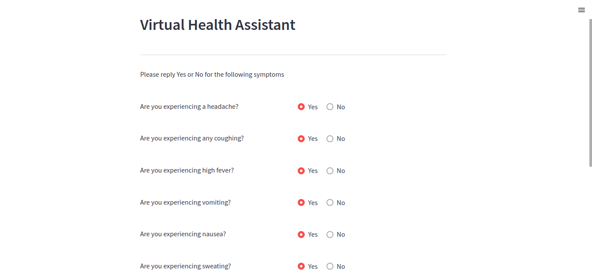
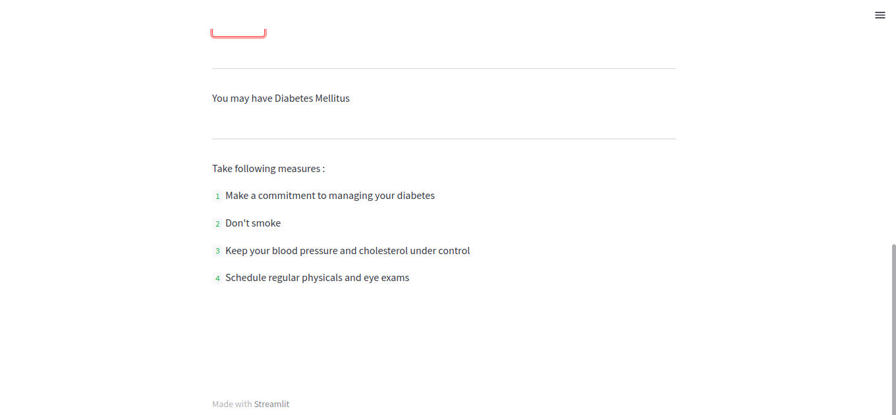

# Symptom-Checker
The symptom checker is a program that predicts the illness that the patient may be suffering from based on the symptoms provided. It directs you to the precautions you can take to control the illness. The symptoms are addressed in a yes-or-no format within a web form that is submitted to the app.

## Home Page ##
The pictures as shown depict the outlook of the web app
## Form page ##

## Results page ##

## Getting started ##
To run this application:

* Clone from here [Symptom Checker](https://github.com/Ngaremaina/Symptom-Checker)
* Install the dependencies: pip install -r requirements.txt
* Start the app: flask --app app run

## Deploying ##
The app is a Flask app, so Vercel detects and deploys it with no extra configuration. Import the GitHub repo in Vercel, or run `vercel --prod` from the project folder.

# Author #
Ngare Maina

